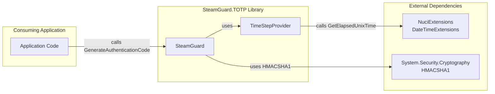
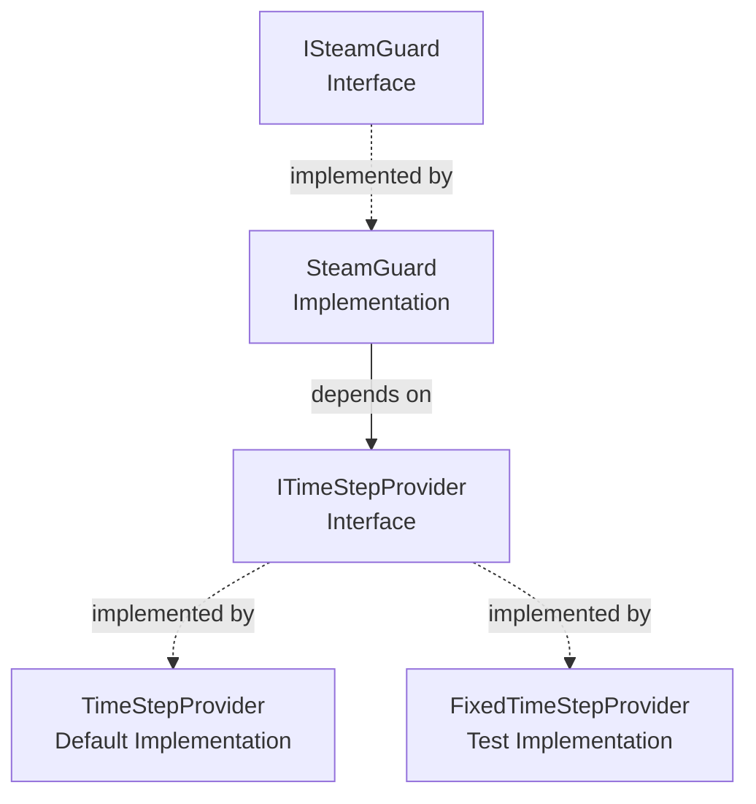
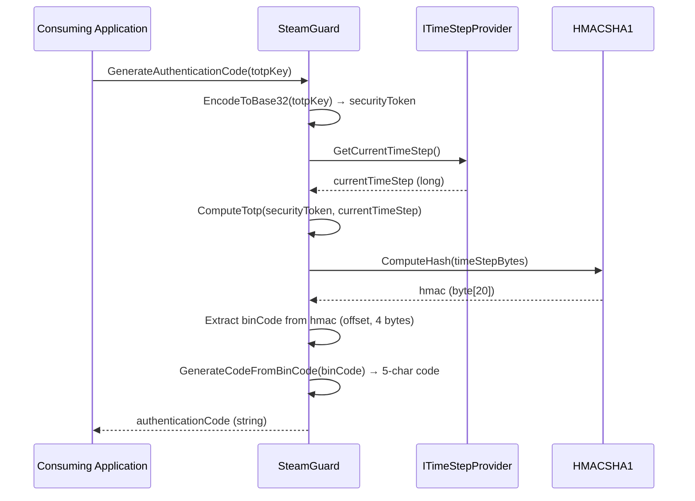
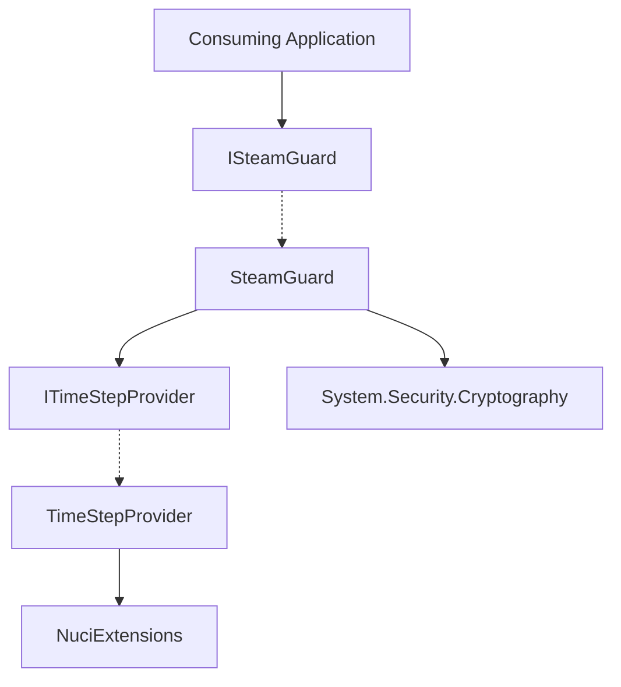

# SteamGuard.TOTP Architecture

This document describes the current architecture of the SteamGuard.TOTP library, a .NET library for generating Steam Guard authentication codes from a Base32 TOTP shared secret.

## 📑 Table of Contents

- [Purpose](#purpose)
- [System Context](#system-context)
- [Architectural Style](#architectural-style)
- [Runtime Flow](#runtime-flow)
- [Components](#components)
- [Dependency Direction and Rules](#dependency-direction-and-rules)
- [External Dependencies](#external-dependencies)
- [Deployment and Operations](#deployment-and-operations)
- [Compatibility Contracts](#compatibility-contracts)
- [Testing and Verification](#testing-and-verification)
- [Design Constraints](#design-constraints)
- [Extension Points](#extension-points)
- [Source Map](#source-map)
- [Related Documentation](#related-documentation)

## 🎯 Purpose

SteamGuard.TOTP is a lightweight .NET library that generates 5-character Steam Guard authentication codes from a Base32-encoded TOTP shared secret. The library exposes a minimal public API (`ISteamGuard`) with a single method `GenerateAuthenticationCode(string totpKey)`. It is designed for dependency injection and deterministic testing through the `ITimeStepProvider` abstraction. The library has no network access, telemetry, or persistent storage.

## 🌐 System Context



The principal external boundaries are:
- **Consuming Application:** Calls `ISteamGuard.GenerateAuthenticationCode` with a Base32 TOTP secret; receives a 5-character authentication code. The application owns the secret lifecycle and decides when to invoke the library.
- **NuciExtensions (NuGet):** Provides `DateTimeExtensions.GetElapsedUnixTime` for calculating the current time step. Compile-time dependency only; no network activity at runtime.
- **System.Security.Cryptography (BCL):** Provides `HMACSHA1` for the TOTP HMAC computation. Part of the .NET Base Class Library.

## 🏗️ Architectural Style

The library follows a **minimal interface-based library** pattern:
- Single public interface (`ISteamGuard`) defining the contract
- Single concrete implementation (`SteamGuard`) with constructor injection of `ITimeStepProvider`
- Time abstraction (`ITimeStepProvider`) enables deterministic testing without system clock coupling
- No internal layering beyond the two interfaces and their implementations
- Pure computation: no I/O, no state, no side effects



The principal architecture boundaries are:
- **Public Contract (`ISteamGuard`):** Stable API surface; consumers depend only on this interface.
- **Time Abstraction (`ITimeStepProvider`):** Isolates time-dependent logic; enables test doubles.
- **Implementation (`SteamGuard`):** Contains the TOTP algorithm; internal detail, not for direct consumption.

## 🔄 Runtime Flow



The principal runtime sequence is:
1. Caller invokes `GenerateAuthenticationCode` with a Base32 TOTP secret
2. Library decodes the Base32 secret to a byte array (`EncodeToBase32`)
3. Library obtains the current time step via `ITimeStepProvider.GetCurrentTimeStep()`
4. Library computes HMAC-SHA1 of the time step using the secret as key
5. Library extracts a 4-byte dynamic truncation from the HMAC (RFC 4226)
6. Library maps the truncated value to 5 characters from the Steam alphabet
7. Library returns the 5-character code to the caller

## 🧩 Components

| Component | Responsibility | Principal Dependencies | Lifetime or Ownership |
|-----------|----------------|------------------------|-----------------------|
| `ISteamGuard` | Public contract for Steam Guard code generation | None (interface) | Singleton per DI container; stateless |
| `SteamGuard` | Implements TOTP algorithm per Steam specification | `ITimeStepProvider`, `System.Security.Cryptography.HMACSHA1` | Transient or singleton; stateless |
| `ITimeStepProvider` | Abstraction for current time step retrieval | None (interface) | Singleton per DI container; stateless |
| `TimeStepProvider` | Default implementation using `DateTime.UtcNow` and `NuciExtensions.DateTimeExtensions` | `NuciExtensions.DateTimeExtensions` | Singleton; stateless |
| `FixedTimeStepProvider` (test) | Test double returning a fixed time step | None | Per-test instance; stateless |

## 🧭 Dependency Direction and Rules



The principal dependency rules are:
- Consumers depend only on `ISteamGuard` (public interface), never on `SteamGuard` directly
- `SteamGuard` depends on `ITimeStepProvider` abstraction, not on `TimeStepProvider` concrete type
- `TimeStepProvider` depends on `NuciExtensions` for time calculation
- `SteamGuard` depends on `System.Security.Cryptography` (BCL) for HMAC-SHA1
- No circular dependencies
- No dependencies on consuming application types

## 📦 External Dependencies

| Dependency | Responsibility | Integration Boundary | Architectural Consequence |
|------------|----------------|----------------------|---------------------------|
| `NuciExtensions` (5.3.1) | Provides `DateTimeExtensions.GetElapsedUnixTime` for Unix time calculation | `TimeStepProvider` | Compile-time only; no runtime network calls; version pinned in csproj |
| `System.Security.Cryptography` (BCL) | Provides `HMACSHA1` for TOTP HMAC computation | `SteamGuard.ComputeTotp` | Part of .NET runtime; no separate versioning |
| `Microsoft.NET.Test.Sdk`, `NUnit`, `Moq`, `NUnit3TestAdapter` | Test framework and mocking | `SteamGuard.TOTP.UnitTests` project | Test-only; not included in NuGet package |

## 🚀 Deployment and Operations

| Concern | Current Design | Architectural Consequence |
|---------|----------------|---------------------------|
| Deployment unit | NuGet package (`SteamGuard.TOTP`) | Consumers add via `dotnet add package`; no separate installation |
| Process topology | In-process library | Runs in consumer's process; no separate service |
| Persistent state | None | No databases, files, or caches managed by library |
| Scaling | Stateless, thread-safe | Scales with consumer application; no shared state |
| Startup/shutdown | No initialization or cleanup required | Zero operational overhead |
| Target framework | `net10.0` | Requires .NET 10 runtime |
| Distribution channels | NuGet.org, GitHub Releases | Versioned releases; semantic versioning |

## 🛡️ Compatibility Contracts

| Contract | Owner | Invariant | Verification | Change Policy |
|----------|-------|-----------|--------------|---------------|
| `ISteamGuard.GenerateAuthenticationCode(string)` | `SteamGuard.TOTP` | Returns 5-character code from Steam alphabet for valid Base32 input | Unit tests with known TOTP vectors | Breaking change requires major version bump |
| `ITimeStepProvider.GetCurrentTimeStep()` | `SteamGuard.TOTP` | Returns current Unix time step (30-second intervals) | Unit tests with `FixedTimeStepProvider` | Stable; new methods only via new interface |
| Steam Guard alphabet (`23456789BCDFGHJKMNPQRTVWXY`) | `SteamGuard` | Fixed character set matching Steam specification | Unit tests verify output characters | Immutable; part of Steam compatibility |
| Base32 decoding alphabet (`ABCDEFGHIJKLMNOPQRSTUVWXYZ234567`) | `SteamGuard` | RFC 4648 Base32 alphabet (no padding) | Unit tests with known secrets | Immutable; part of Steam compatibility |

## ✅ Testing and Verification

The test project `SteamGuard.TOTP.UnitTests` verifies:
- Correct code generation against known TOTP test vectors (RFC 4226 / Steam-specific)
- Code length and character set compliance
- Deterministic output via `FixedTimeStepProvider` test double
- Edge cases: empty string throws `InvalidOperationException`, null throws `NullReferenceException`

Execute the principal automated verification with:

```bash
dotnet test
```

Or with verbosity:

```bash
dotnet test --verbosity normal
```

## ⚠️ Design Constraints

- **Algorithm fixed to HMAC-SHA1:** Steam Guard uses HMAC-SHA1 per RFC 4226; cannot be changed without breaking Steam compatibility
- **Time step fixed to 30 seconds:** Per TOTP RFC 6238 and Steam implementation
- **Code length fixed to 5 characters:** Steam-specific; not configurable
- **Alphabet fixed to Steam character set:** Excludes ambiguous characters (0, 1, 8, I, L, O, U, Z)
- **No input validation:** Library assumes valid Base32 input; callers should validate if needed
- **No threading guarantees documented:** Implementation is stateless and thread-safe by design, but not explicitly specified
- **Single target framework (net10.0):** No multi-targeting; consumers must use .NET 10+
- **GPL-3.0-or-later license:** Copyleft; imposes licensing obligations on consumers

## 🔌 Extension Points

| Extension Point | Contract | Registration / Integration |
|-----------------|----------|----------------------------|
| `ITimeStepProvider` | `long GetCurrentTimeStep()` | Pass custom implementation to `SteamGuard` constructor for testing, simulation, or alternative time sources |
| `ISteamGuard` | `string GenerateAuthenticationCode(string totpKey)` | Implement alternative algorithms (e.g., different TOTP variants) and register in DI container |

## 📂 Source Map

| Area | Repository Path |
|------|-----------------|
| Public contracts | `SteamGuard.TOTP/ISteamGuard.cs`, `SteamGuard.TOTP/ITimeStepProvider.cs` |
| Core implementation | `SteamGuard.TOTP/SteamGuard.cs`, `SteamGuard.TOTP/TimeStepProvider.cs` |
| Test utilities | `SteamGuard.TOTP.UnitTests/Utils/FixedTimeStepProvider.cs` |
| Tests | `SteamGuard.TOTP.UnitTests/SteamGuardTests.cs` |
| Build configuration | `SteamGuard.TOTP/SteamGuard.TOTP.csproj`, `SteamGuard.TOTP.UnitTests/SteamGuard.TOTP.UnitTests.csproj` |
| Solution | `SteamGuard.TOTP.sln` |
| CI/CD | `.github/workflows/dotnet.yml` |

## 📚 Related Documentation

- [README.md](./README.md) — Project overview, installation, quick start, API reference
- [PRIVACY.md](./PRIVACY.md) — Data handling description (no personal data collected)
- [SECURITY.md](./SECURITY.md) — Security policy, supported versions, vulnerability reporting
- [CONTRIBUTING.md](./CONTRIBUTING.md) — Contribution guidelines
- [LICENSE](./LICENSE) — GNU GPL v3.0 or later