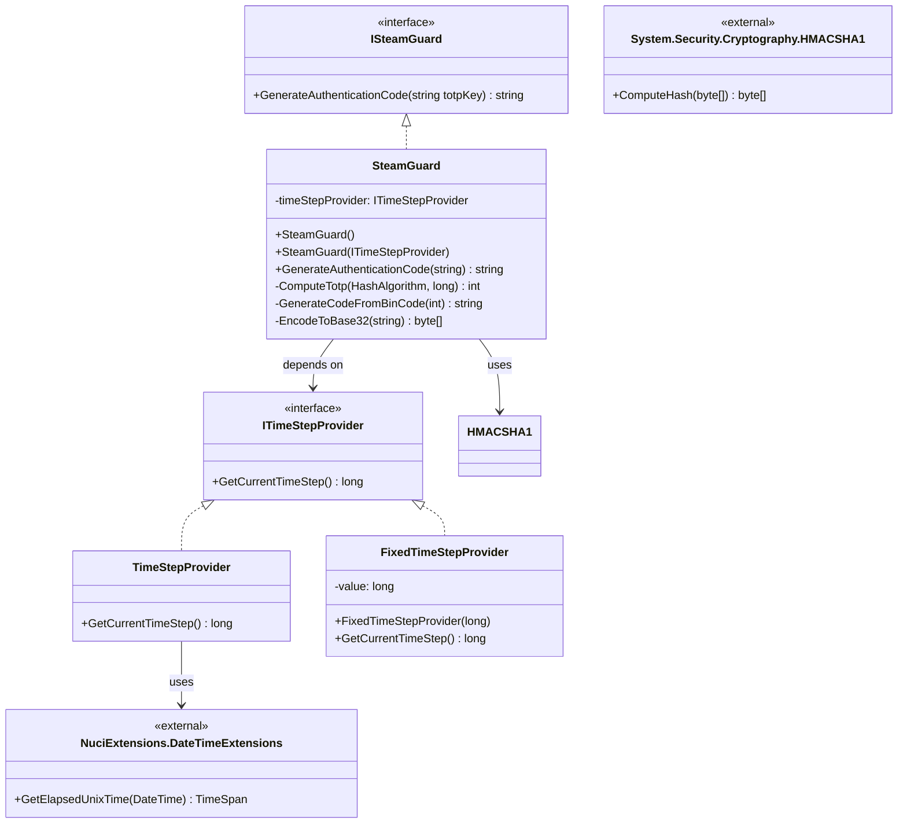
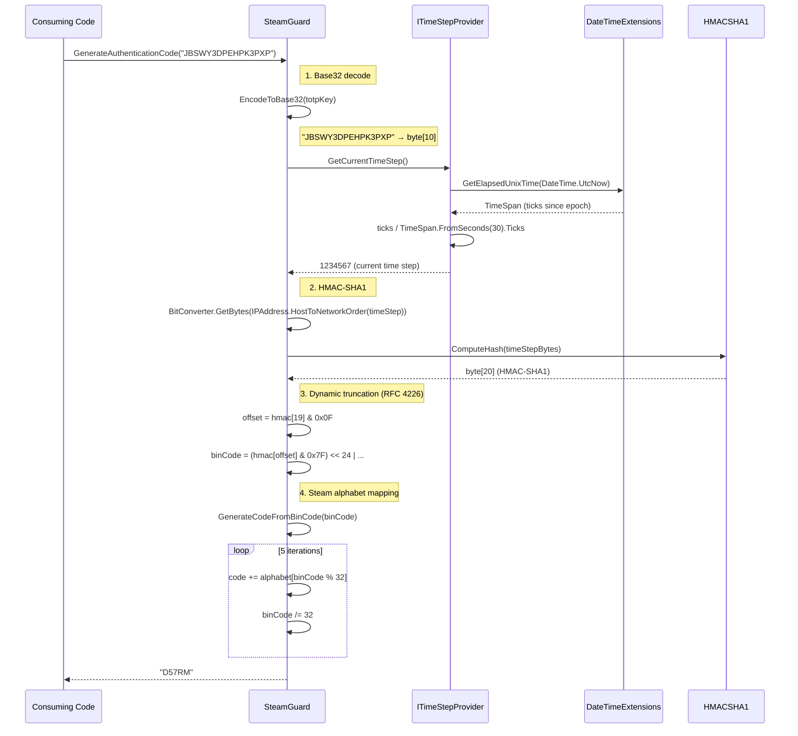

# Architecture (Detailed)

This document elaborates on the root [ARCHITECTURE.md](../ARCHITECTURE.md) with implementation-level detail for contributors and maintainers.

## Architectural Style: Minimal Interface-Based Library

The library follows a **minimal interface-based library** pattern with these characteristics:

1. **Single public interface** (`ISteamGuard`) — defines the entire public contract
2. **Single implementation** (`SteamGuard`) — contains all algorithmic logic
3. **One abstraction for testability** (`ITimeStepProvider`) — isolates time dependency
4. **Zero internal layering** — no repositories, services, handlers, or mediators
5. **Pure computation** — no I/O, no state, no side effects

## Component Diagram (Detailed)



## Internal Module Dependencies

```
SteamGuard.TOTP (assembly)
├── SteamGuard.TOTP.ISteamGuard          (public interface)
├── SteamGuard.TOTP.ITimeStepProvider    (public interface)
├── SteamGuard.TOTP.SteamGuard           (internal implementation)
└── SteamGuard.TOTP.TimeStepProvider     (internal implementation)

SteamGuard.TOTP.UnitTests (test assembly)
├── SteamGuard.TOTP.UnitTests.SteamGuardTests
└── SteamGuard.TOTP.UnitTests.Utils.FixedTimeStepProvider
```

**Dependency rules enforced by project structure:**
- Library has no reference to test project
- Test project references library
- No circular dependencies possible

## Runtime Flow: GenerateAuthenticationCode

### Sequence Diagram (Detailed)



### Step-by-Step Breakdown

| Step | Method | Input | Output | Purpose |
|------|--------|-------|--------|---------|
| 1 | `EncodeToBase32` | Base32 string | `byte[]` (key) | Decode RFC 4648 Base32 (no padding) |
| 2 | `ITimeStepProvider.GetCurrentTimeStep` | — | `long` (time step) | Get current 30-second interval since Unix epoch |
| 3 | `ComputeTotp` | key, time step | `int` (binCode) | HMAC-SHA1 + dynamic truncation |
| 4 | `GenerateCodeFromBinCode` | binCode | `string` (5 chars) | Map to Steam alphabet |

## Algorithmic Details

### Base32 Decoding (`EncodeToBase32`)

```csharp
static readonly string AllowedTotpKeyCharacters = "ABCDEFGHIJKLMNOPQRSTUVWXYZ234567";

static byte[] EncodeToBase32(string source)
{
    string bits = source
        .ToUpper()
        .ToCharArray()
        .Select(c => Convert.ToString(AllowedTotpKeyCharacters.IndexOf(c), 2).PadLeft(5, '0'))
        .Aggregate((a, b) => a + b);

    return Enumerable
        .Range(0, bits.Length / 8)
        .Select(i => Convert.ToByte(bits.Substring(i * 8, 8), 2))
        .ToArray();
}
```

- **Alphabet:** `A-Z`, `2-7` (32 chars, RFC 4648)
- **No padding:** Input length must be multiple of 8 chars (40 bits → 5 bytes)
- **Case-insensitive:** Input converted to upper case
- **No validation:** Invalid chars return index -1 → exception in `Convert.ToString`

### Time Step Calculation (`TimeStepProvider`)

```csharp
static readonly TimeSpan Interval = TimeSpan.FromSeconds(30);

public long GetCurrentTimeStep()
    => DateTimeExtensions.GetElapsedUnixTime(DateTime.UtcNow).Ticks / Interval.Ticks;
```

- **Interval:** 30 seconds (TOTP standard RFC 6238)
- **Epoch:** Unix epoch (Jan 1, 1970 UTC)
- **Source:** `NuciExtensions.DateTimeExtensions.GetElapsedUnixTime`
- **Return:** Integer count of 30-second intervals since epoch

### HMAC-SHA1 + Dynamic Truncation (`ComputeTotp`)

```csharp
int ComputeTotp(HashAlgorithm algorithm)
{
    long currentTimeStep = timeStepProvider.GetCurrentTimeStep();
    var bytes = BitConverter.GetBytes(IPAddress.HostToNetworkOrder((long)currentTimeStep));
    var hmac = algorithm.ComputeHash(bytes);
    byte offset = (byte)(hmac[19] & 15);

    int binCode =
        ((hmac[offset] & 127) << 24) |
        ((hmac[offset + 1] & 255) << 16) |
        ((hmac[offset + 2] & 255) << 8) |
        (hmac[offset + 3] & 255);

    return binCode;
}
```

- **Hash:** HMAC-SHA1 (20 bytes output)
- **Endianness:** Network byte order (big-endian) for time step
- **Truncation:** RFC 4226 dynamic truncation
  - Offset = last 4 bits of HMAC (0-15)
  - Extract 4 bytes starting at offset
  - Mask MSB of first byte (31-bit positive integer)

### Steam Alphabet Mapping (`GenerateCodeFromBinCode`)

```csharp
static readonly string AuthenticationCodeAlphabet = "23456789BCDFGHJKMNPQRTVWXY";
static readonly int CodeLength = 5;

static string GenerateCodeFromBinCode(int binCode)
{
    string code = string.Empty;
    for (int i = 0; i < CodeLength; ++i)
    {
        code += AuthenticationCodeAlphabet[binCode % AuthenticationCodeAlphabet.Length];
        binCode /= AuthenticationCodeAlphabet.Length;
    }
    return code;
}
```

- **Alphabet:** 32 characters (excludes 0, 1, 8, I, L, O, U, Z)
- **Length:** 5 characters fixed
- **Encoding:** Base-32 representation of binCode (least significant digit first)

## Design Constraints (Implementation-Level)

| Constraint | Location | Rationale |
|------------|----------|-----------|
| HMAC-SHA1 only | `SteamGuard.ComputeTotp` | Steam Guard specification |
| 30-second interval | `TimeStepProvider.Interval` | TOTP RFC 6238 |
| 5-character output | `SteamGuard.CodeLength` | Steam Guard specification |
| Fixed alphabet | `SteamGuard.AuthenticationCodeAlphabet` | Steam Guard specification |
| No input validation | `SteamGuard.GenerateAuthenticationCode` | Minimal API; caller responsibility |
| No threading model | N/A | Stateless → inherently thread-safe |
| net10.0 only | `.csproj` | Modern .NET; no multi-targeting |

## Extension Points (Implementation-Level)

| Extension Point | Contract | Usage |
|-----------------|----------|-------|
| `ITimeStepProvider` | `long GetCurrentTimeStep()` | Inject `FixedTimeStepProvider` for tests; inject custom for simulation |
| `ISteamGuard` | `string GenerateAuthenticationCode(string)` | Replace `SteamGuard` with alternative implementation in DI |

## Source References

| Concept | File | Line Range |
|---------|------|------------|
| Public interface | `SteamGuard.TOTP/ISteamGuard.cs` | 1-10 |
| Time abstraction | `SteamGuard.TOTP/ITimeStepProvider.cs` | 1-8 |
| Core algorithm | `SteamGuard.TOTP/SteamGuard.cs` | 1-80 |
| Default time provider | `SteamGuard.TOTP/TimeStepProvider.cs` | 1-15 |
| Test double | `SteamGuard.TOTP.UnitTests/Utils/FixedTimeStepProvider.cs` | 1-10 |
| Test vectors | `SteamGuard.TOTP.UnitTests/SteamGuardTests.cs` | 20-50 |