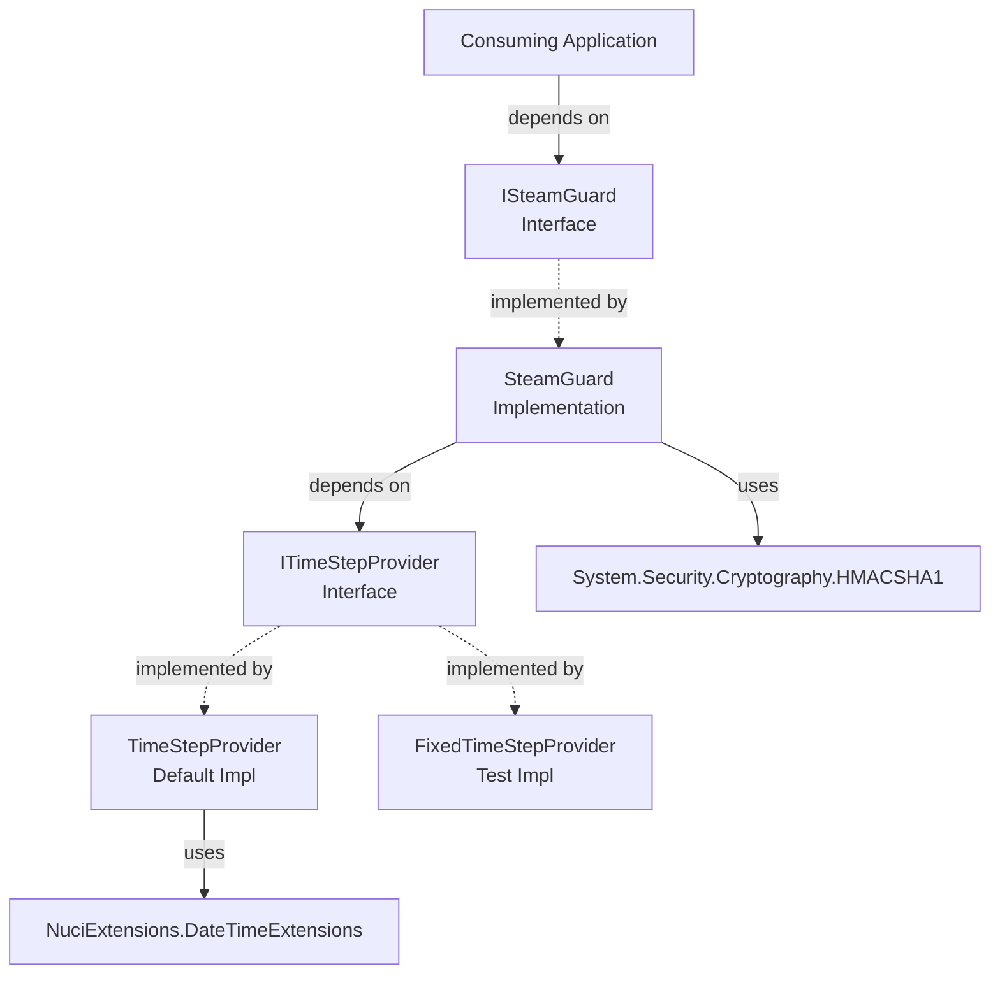

# Components Overview

This document catalogues all components in the SteamGuard.TOTP library with their responsibilities, dependencies, and ownership.

## Component Catalogue

| Component | Type | Location | Responsibility |
|-----------|------|----------|----------------|
| `ISteamGuard` | Interface | `SteamGuard.TOTP/ISteamGuard.cs` | Public contract for Steam Guard code generation |
| `SteamGuard` | Class | `SteamGuard.TOTP/SteamGuard.cs` | TOTP algorithm implementation (HMAC-SHA1, Base32, truncation, alphabet mapping) |
| `ITimeStepProvider` | Interface | `SteamGuard.TOTP/ITimeStepProvider.cs` | Abstraction for current time-step retrieval |
| `TimeStepProvider` | Class | `SteamGuard.TOTP/TimeStepProvider.cs` | Default implementation using system clock + NuciExtensions |
| `FixedTimeStepProvider` | Class | `SteamGuard.TOTP.UnitTests/Utils/FixedTimeStepProvider.cs` | Test double returning fixed time step |

## Component Relationships

## Responsibility Matrix

| Responsibility | Owner | Collaborators |
|----------------|-------|---------------|
| Public API definition | `ISteamGuard` | — |
| TOTP algorithm | `SteamGuard` | `ITimeStepProvider`, `HMACSHA1` |
| Base32 decoding | `SteamGuard.EncodeToBase32` | — |
| HMAC-SHA1 computation | `SteamGuard.ComputeTotp` | `HMACSHA1` |
| Dynamic truncation | `SteamGuard.ComputeTotp` | — |
| Steam alphabet mapping | `SteamGuard.GenerateCodeFromBinCode` | — |
| Time-step abstraction | `ITimeStepProvider` | — |
| System time integration | `TimeStepProvider` | `NuciExtensions.DateTimeExtensions` |
| Deterministic time for tests | `FixedTimeStepProvider` | — |

## Lifetime and Ownership

| Component | Lifetime | Owner | Notes |
|-----------|----------|-------|-------|
| `ISteamGuard` | Per DI registration | Consumer | Typically singleton (stateless) |
| `SteamGuard` | Per DI registration | Consumer | Stateless; singleton or transient |
| `ITimeStepProvider` | Per DI registration | Consumer | Typically singleton (stateless) |
| `TimeStepProvider` | Per DI registration | Consumer | Stateless; singleton |
| `FixedTimeStepProvider` | Per test | Test case | New instance per test |

## Dependency Direction Rules

1. **Consumers** → `ISteamGuard` (only public interface)
2. **`SteamGuard`** → `ITimeStepProvider` (abstraction, not concrete)
3. **`TimeStepProvider`** → `NuciExtensions` (compile-time)
4. **`SteamGuard`** → `System.Security.Cryptography` (BCL)
5. **No reverse dependencies** — library never depends on consumer types
6. **No circular dependencies** — enforced by project structure

## Testing Components

| Test Component | Location | Purpose |
|----------------|----------|---------|
| `SteamGuardTests` | `SteamGuard.TOTP.UnitTests/SteamGuardTests.cs` | Verifies algorithm correctness against known vectors |
| `FixedTimeStepProvider` | `SteamGuard.TOTP.UnitTests/Utils/FixedTimeStepProvider.cs` | Provides deterministic time steps for reproducible tests |

## External Dependencies (Components)

| Dependency | Used By | Purpose |
|------------|---------|---------|
| `NuciExtensions.DateTimeExtensions` | `TimeStepProvider` | Unix time calculation |
| `System.Security.Cryptography.HMACSHA1` | `SteamGuard` | HMAC-SHA1 computation |
| `System.Net.IPAddress` | `SteamGuard` | Network byte order conversion |
| `System.Linq` | `SteamGuard` | Base32 decoding pipeline |
| `Moq` | `SteamGuardTests` | Mocking `ITimeStepProvider` |
| `NUnit` | `SteamGuardTests` | Test framework |