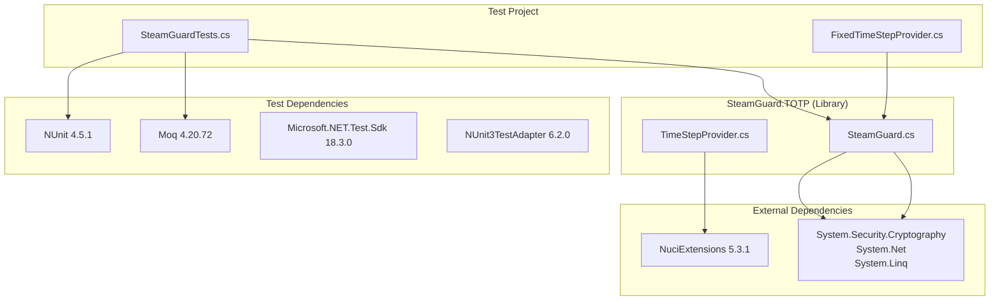
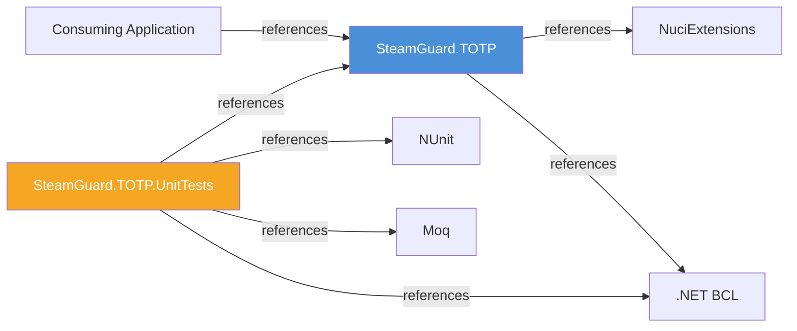

# Dependencies

This document catalogues all dependencies used by the SteamGuard.TOTP library.

## Dependency Classification



## Production Dependencies

### Direct Dependencies

| Dependency | Version | Type | Used By | Purpose |
|------------|---------|------|---------|---------|
| `NuciExtensions` | 5.3.1 | NuGet package | `TimeStepProvider` | `DateTimeExtensions.GetElapsedUnixTime` for Unix time calculation |

### Transitive Dependencies

| Dependency | Version | Used By | Purpose |
|------------|---------|---------|---------|
| `System.Security.Cryptography` | BCL | `SteamGuard` | `HMACSHA1` for TOTP computation |
| `System.Net` | BCL | `SteamGuard` | `IPAddress.HostToNetworkOrder` for big-endian conversion |
| `System.Linq` | BCL | `SteamGuard` | LINQ operations in `EncodeToBase32` |
| `System` | BCL | `SteamGuard` | `Convert`, `BitConverter`, `TimeSpan` |

### .NET Base Class Library (BCL)

The library relies on the following BCL types:

| Type | Namespace | Used By | Purpose |
|------|-----------|---------|---------|
| `HMACSHA1` | `System.Security.Cryptography` | `SteamGuard.ComputeTotp` | HMAC-SHA1 computation |
| `HashAlgorithm` | `System.Security.Cryptography` | `SteamGuard.ComputeTotp` | Algorithm abstraction |
| `IPAddress` | `System.Net` | `SteamGuard.ComputeTotp` | Network byte order conversion |
| `BitConverter` | `System` | `SteamGuard.ComputeTotp` | Long to byte array conversion |
| `Convert` | `System` | `SteamGuard.EncodeToBase32` | Base32 character to binary conversion |
| `Enumerable` | `System.Linq` | `SteamGuard.EncodeToBase32` | LINQ pipeline for decoding |
| `TimeSpan` | `System` | `TimeStepProvider` | 30-second interval definition |
| `DateTime` | `System` | `TimeStepProvider` | Current UTC time |

## Test Dependencies

| Dependency | Version | Purpose |
|------------|---------|---------|
| `Microsoft.NET.Test.Sdk` | 18.3.0 | Test runner infrastructure |
| `NUnit` | 4.5.1 | Test framework (attributes, assertions) |
| `NUnit3TestAdapter` | 6.2.0 | NUnit integration with `dotnet test` |
| `Moq` | 4.20.72 | Mocking `ITimeStepProvider` interface |

## Dependency Direction Rules



**Rules:**
1. Library depends only on `NuciExtensions` and BCL
2. Test project depends on library, test frameworks, and BCL
3. Library never depends on test project
4. No circular dependencies

## Version Pinning

| Dependency | Version | Pinning Strategy |
|------------|---------|-----------------|
| `NuciExtensions` | 5.3.1 | Exact version in csproj |
| `Microsoft.NET.Test.Sdk` | 18.3.0 | Exact version in csproj |
| `NUnit` | 4.5.1 | Exact version in csproj |
| `NUnit3TestAdapter` | 6.2.0 | Exact version in csproj |
| `Moq` | 4.20.72 | Exact version in csproj |

## Security Considerations

| Dependency | Security Notes |
|------------|----------------|
| `NuciExtensions` | Compile-time only; no runtime network calls; reviewed for security |
| `System.Security.Cryptography` | BCL; maintained by Microsoft; HMACSHA1 is FIPS-compliant |
| `Moq` | Test-only; not included in NuGet package |
| `NUnit` | Test-only; not included in NuGet package |

## Update Policy

| Dependency | Update Frequency | Process |
|------------|-----------------|---------|
| `NuciExtensions` | As needed | Manual review; check changelog; run tests |
| BCL | With .NET SDK | Follow .NET release cycle |
| Test frameworks | As needed | Manual review; run tests |

## Checking for Vulnerabilities

```bash
# Check for known vulnerabilities
dotnet list package --vulnerable

# Check for outdated packages
dotnet list package --outdated

# Run security analysis
dotnet build /p:EnableNETAnalyzers=true
```

## Dependency Verification

All dependencies are verified via:
1. `dotnet restore` — resolves and downloads packages
2. `dotnet build` — compiles against resolved versions
3. `dotnet test` — validates behavior with resolved versions
4. CI pipeline runs all three steps on every push/PR