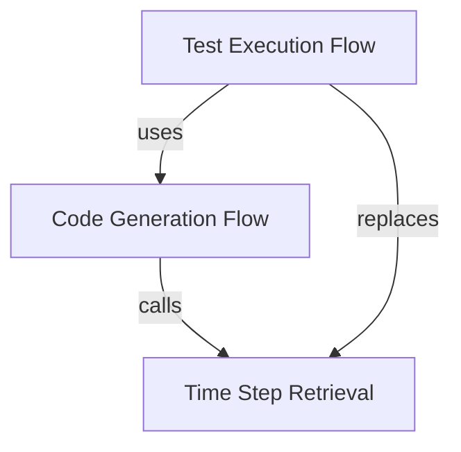

# Flows Overview

This document catalogues the end-to-end execution flows in the SteamGuard.TOTP library.

## Flow Catalogue

| Flow | Description | Entry Point | Key Components |
|------|-------------|-------------|----------------|
| Code Generation | Generate Steam Guard code from Base32 secret | `ISteamGuard.GenerateAuthenticationCode` | `SteamGuard`, `ITimeStepProvider`, `HMACSHA1` |
| Time Step Retrieval | Get current 30-second interval since epoch | `ITimeStepProvider.GetCurrentTimeStep` | `TimeStepProvider`, `NuciExtensions.DateTimeExtensions` |
| Test Execution | Deterministic code generation for verification | `SteamGuardTests` | `FixedTimeStepProvider`, `SteamGuard`, NUnit/Moq |

## Flow Relationships

## Navigation

- [Code Generation Flow](./code-generation.md) — Detailed sequence for `GenerateAuthenticationCode`
- [Test Execution Flow](./test-execution.md) — How tests verify the algorithm