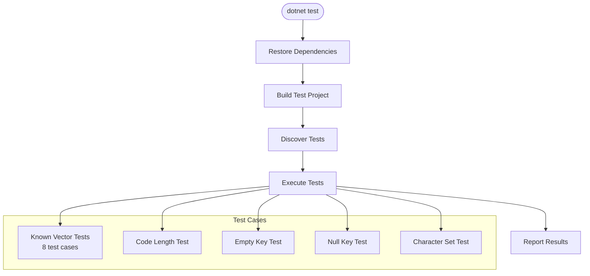

# Test Execution Flow

This document describes how the test suite verifies the SteamGuard.TOTP algorithm.

## Test Project Structure

**Location:** `SteamGuard.TOTP.UnitTests/`
**Framework:** NUnit 4.5.1 with Moq 4.20.72
**Test Adapter:** NUnit3TestAdapter 6.2.0

## Test Classes

### SteamGuardTests

**Location:** `SteamGuard.TOTP.UnitTests/SteamGuardTests.cs`
**Namespace:** `SteamGuard.TOTP.UnitTests`

#### Setup

```csharp
[SetUp]
public void SetUp()
{
    timeStepProviderMock = new Mock<ITimeStepProvider>();
    steamGuard = new SteamGuard(timeStepProviderMock.Object);
}
```

- Creates fresh `Mock<ITimeStepProvider>` per test
- Creates `SteamGuard` with mocked time provider
- Ensures test isolation

#### Primary Test: Known Vector Verification

```csharp
[Test]
[TestCase("DPNAMYILQFCAOTVS32XGGV3DSX5JYSP3", 613, "D57RM")]
[TestCase("E4VVBJK7RU43Q2V1VSZC14BXMMH3ZLPB", 1, "P8JF7")]
[TestCase("E4VVBJK7RU43Q2V1VSZC14BXMMH3ZLPB", 3, "58XVX")]
[TestCase("E4VVBJK7RU43Q2V1VSZC14BXMMH3ZLPB", 54600835, "W32KJ")]
[TestCase("SQUTXBT56XIDXZ63UBVVMK3ORG4ZDRCF", 873, "W28WD")]
[TestCase("TY1YEH2Y21OCUAEIJ47AV8E068W8HUEM", 1, "XQ4CH")]
[TestCase("TY1YEH2Y21OCUAEIJ47AV8E068W8HUEM", 3, "58RH6")]
[TestCase("TY1YEH2Y21OCUAEIJ47AV8E068W8HUEM", 54600835, "7WWPY")]
public void GivenSteamGuard_WhenGeneratingAnAuthenticationCode_ThenTheCorrectCodeIsReturned(
    string totpKey, long timeStep, string expectedCode)
{
    timeStepProviderMock
        .Setup(x => x.GetCurrentTimeStep())
        .Returns(timeStep);

    Assert.That(steamGuard.GenerateAuthenticationCode(totpKey), Is.EqualTo(expectedCode));
}
```

**Flow:**
1. Mock `ITimeStepProvider.GetCurrentTimeStep()` to return fixed `timeStep`
2. Call `SteamGuard.GenerateAuthenticationCode(totpKey)`
3. Assert result equals `expectedCode`

**Test Vectors Source:** Steam Guard compatible TOTP implementations (validated against known Steam shared secrets)

#### Secondary Test: Code Length

```csharp
[Test]
public void GenerateAuthenticationCode_ReturnsCodeOfCorrectLength()
{
    SteamGuard sg = new(new FixedTimeStepProvider(FixedTimeStep));
    string code = sg.GenerateAuthenticationCode(ValidTotpKey);
    Assert.That(code.Length, Is.EqualTo(5));
}
```

**Flow:**
1. Create `SteamGuard` with `FixedTimeStepProvider` (deterministic)
2. Call `GenerateAuthenticationCode` with valid key
3. Assert output length is exactly 5

#### Edge Case Tests

```csharp
[Test]
public void GenerateAuthenticationCode_ThrowsOnEmptyKey()
{
    Assert.Throws<InvalidOperationException>(() => 
        steamGuard.GenerateAuthenticationCode(""));
}

[Test]
public void GenerateAuthenticationCode_ThrowsOnNullKey()
{
    Assert.Throws<NullReferenceException>(() => 
        steamGuard.GenerateAuthenticationCode(null!));
}
```

**Flow:**
1. Call `GenerateAuthenticationCode` with empty string / null
2. Assert expected exception type is thrown

#### Character Set Test

```csharp
[Test]
public void GenerateAuthenticationCode_ReturnsOnlyAllowedCharacters()
{
    SteamGuard sg = new(new FixedTimeStepProvider(FixedTimeStep));
    string code = sg.GenerateAuthenticationCode(ValidTotpKey);
    Assert.That(code.All(c => AllowedCharacters.Contains(c)), Is.True);
}
```

**Flow:**
1. Generate code with deterministic time
2. Assert all characters are in Steam alphabet `23456789BCDFGHJKMNPQRTVWXY`

## Test Double: FixedTimeStepProvider

**Location:** `SteamGuard.TOTP.UnitTests/Utils/FixedTimeStepProvider.cs`

```csharp
public sealed class FixedTimeStepProvider(long value) : ITimeStepProvider
{
    public long GetCurrentTimeStep() => value;
}
```

**Purpose:** Provides deterministic time steps for reproducible tests

**Usage:**
- Direct instantiation: `new FixedTimeStepProvider(613)`
- Used in tests that don't need mocking (simpler, no Moq overhead)

## Test Execution Flow



## CI/CD Integration

**Workflow:** `.github/workflows/dotnet.yml`

```yaml
- name: Test
  run: dotnet test --no-build --verbosity normal
```

**Execution:**
1. `dotnet restore` — restore NuGet packages
2. `dotnet build --no-restore` — compile library and tests
3. `dotnet test --no-build --verbosity normal` — run tests with output

**Output Example:**
```
Test run for /home/horatiu/Proiecte/steamguard.totp/SteamGuard.TOTP.UnitTests/bin/Debug/net10.0/SteamGuard.TOTP.UnitTests.dll
Microsoft (R) Test Execution Command Line Tool Version 18.3.0
Copyright (c) Microsoft Corporation.  All rights reserved.

Starting test execution, please wait...
Passed!  - Failed: 0, Passed: 12, Total: 12
```

## Coverage Analysis

| Area | Covered | Test Method |
|------|---------|-------------|
| `GenerateAuthenticationCode` happy path | ✅ | `GivenSteamGuard_WhenGeneratingAnAuthenticationCode_ThenTheCorrectCodeIsReturned` |
| Base32 decoding | ✅ | Indirect via known vectors |
| Time step retrieval | ✅ | Mocked / FixedTimeStepProvider |
| HMAC-SHA1 computation | ✅ | Indirect via known vectors |
| Dynamic truncation | ✅ | Indirect via known vectors |
| Steam alphabet mapping | ✅ | `GenerateAuthenticationCode_ReturnsOnlyAllowedCharacters` |
| Code length | ✅ | `GenerateAuthenticationCode_ReturnsCodeOfCorrectLength` |
| Empty key handling | ✅ | `GenerateAuthenticationCode_ThrowsOnEmptyKey` |
| Null key handling | ✅ | `GenerateAuthenticationCode_ThrowsOnNullKey` |
| Different time steps | ✅ | Multiple test cases with varying time steps |
| Different secrets | ✅ | 3 distinct secrets in test vectors |

## Gaps and Limitations

| Gap | Impact | Mitigation |
|-----|--------|------------|
| No invalid Base32 character test | Medium | Could add test with invalid chars |
| No performance benchmarks | Low | Not critical for this library |
| No concurrency tests | Low | Stateless design implies thread safety |
| No integration tests | N/A | No external integrations |
| No property-based testing | Low | Fixed test vectors sufficient for algorithm |

## Running Tests Locally

```bash
# Run all tests
dotnet test

# Run with verbosity
dotnet test --verbosity normal

# Run specific test class
dotnet test --filter "FullyQualifiedName~SteamGuardTests"

# Run specific test method
dotnet test --filter "FullyQualifiedName~GivenSteamGuard_WhenGeneratingAnAuthenticationCode_ThenTheCorrectCodeIsReturned"

# Run with TRX output
dotnet test --logger "trx;LogFileName=test_results.trx"
```

## Test Maintenance

- **Add new test vectors** when Steam algorithm changes (unlikely)
- **Update test cases** if Base32 alphabet or Steam alphabet changes
- **Keep `FixedTimeStepProvider`** in sync with `ITimeStepProvider` interface
- **Verify mocks** match interface signature changes